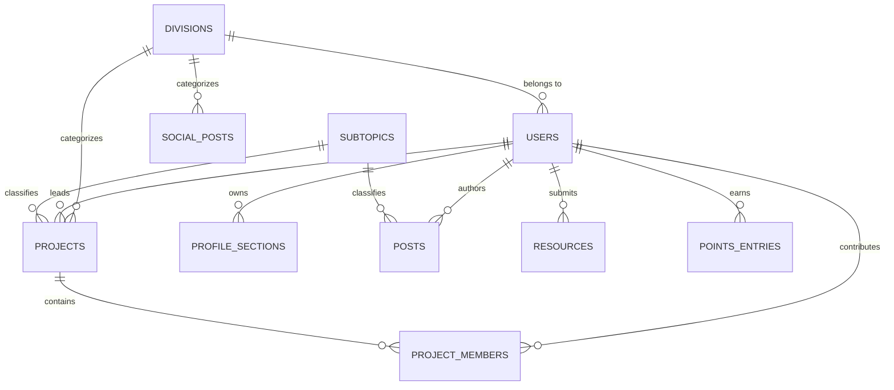
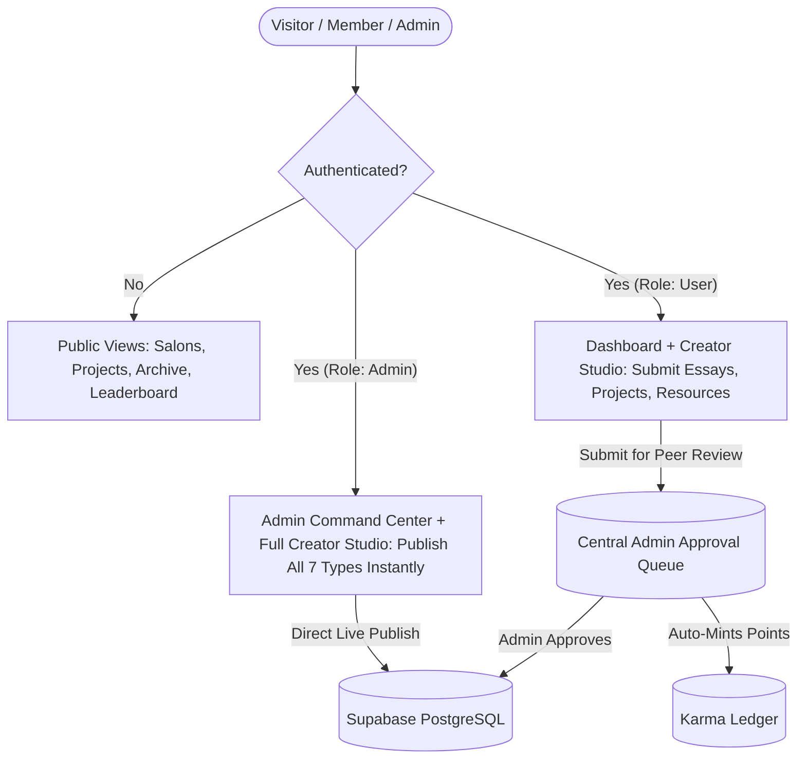

# ADVAIT COLLECTIVE — COMPLETE PROJECT ARCHITECTURE & MODULE AUDIT
**Generated Checkpoint Date:** November 2026  
**Repository Working Copy:** `c:\Users\Bivash\Desktop\advait`  
**Primary Engine:** Next.js 16.4.6 (App Router + Turbopack) · React 19 · TypeScript 5 · Drizzle ORM · Supabase PostgreSQL & Storage

---

## 1. PROJECT EXECUTIVE SUMMARY & PHILOSOPHY

Advait is the digital headquarters and technical proving ground for the **Association of Developers and Visionaries in AI & Tech**. It serves as an open architectural commons where engineers, researchers, and systems architects publish technical research essays, collaborate on open-source artifacts, participate in architecture salons, and build reputation through a transparent on-chain style karma ledger.

### Core Architectural Rules Enforced
1. **Zero Mock Data Policy:** All frontend mock arrays, placeholder fallbacks, and dummy seed constants have been eliminated from the UI. If the database is empty, the site renders authentic Swiss empty states with direct dispatch action triggers.
2. **Strict Single Environment File:** Configuration exclusively reads from `.env` (never `.env.local`).
3. **No-Emoji Brutalist Typography:** All decorative emojis have been scrubbed. The interface uses high-contrast Swiss typography, monospace coordinates, brackets (`[01]`, `[SALON]`, `[NEWS]`), and ASCII glyphs (`+`, `->`).
4. **Unified Creator Engine:** All disparate modal creation dialogs have been consolidated into a single dedicated **Creator Studio** at `/publish`.
5. **Real-Time Synchronous Clocks:** All upcoming salons and events feature ticking digital countdown timers in real time.

---

## 2. TECH STACK SPECIFICATION — WHAT WAS USED VS. WHAT WAS NOT

| Category | Technology Used | What Was NOT Used / Rejected | Architectural Rationale |
| :--- | :--- | :--- | :--- |
| **Framework** | **Next.js 16.4.6 (App Router + Turbopack)** | Vite SPA, Pages Router, Express.js | Next.js 16 App Router provides server-side rendering, streaming, Turbopack builds, and unified API routes in a single deployable unit. |
| **UI Runtimes** | **React 19 & React DOM 19** | Vue, Svelte, Angular | Deep ecosystem compatibility with Next.js 16, concurrent features, and server components. |
| **ORM / Query Engine** | **Drizzle ORM (`drizzle-orm` + `drizzle-kit`)** | Prisma, TypeORM, raw SQL strings | Drizzle provides zero-overhead, type-safe SQL queries with serverless connection pooling support, schema transparency, and zero binary engine footprint. |
| **Database** | **Supabase PostgreSQL** | MongoDB, MySQL, SQLite | Relational integrity with foreign keys, JSONB support for polymorphic dossiers, native text arrays (`text[]`), and connection pooling. |
| **Asset Storage** | **Supabase Storage (Public bucket `media`)** | AWS S3, Cloudinary, Local filesystem | Direct HTTP multipart upload handler (`/api/uploads`) writing directly to Supabase Storage with permanent public asset URLs. |
| **Authentication** | **Custom JWT Session Cookies (`jose` + `bcryptjs`)** | NextAuth OAuth redirects, Supabase Auth UI | Clean, lightweight, self-contained credentials authentication using HTTP-only `advait_session` cookies, protecting user privacy and preventing vendor lock-in. |
| **Validation** | **Zod (`zod`)** | Joi, Yup, manual `if` checks | Strict compile-time and runtime validation across all POST/PATCH/DELETE API payloads. |
| **Styling** | **Bespoke CSS Modules (`*.module.css`)** | Tailwind CSS, Styled Components | High-performance scoped styling with Swiss grid layout, cubic-bezier spring curves, dark obsidian glassmorphism, and zero utility class bloat. |
| **Markdown Engine** | **ReactMarkdown (`react-markdown`)** | Raw `dangerouslySetInnerHTML`, Rich text WYSIWYG | Secure, sanitised markdown rendering for technical essays, code fences, blockquotes, and image embeds. |
| **Clocks & Timers** | **Bespoke `CountdownTimer` Component** | Heavy external countdown libraries | Zero-dependency client-side tick loop recalculating days/hours/minutes/seconds against target UTC timestamps every 1,000ms. |

---

## 3. DATABASE SCHEMA BREAKDOWN (`db/schema.ts`)

The database consists of 12 normalized relational tables configured in PostgreSQL via Drizzle ORM:



### Table Specifications:

#### 1. `divisions`
Represents the 5 specialized engineering and creative guilds of Advait:
- `RED`: Research & Engineering Division
- `OPS`: Operations, Infrastructure & Cloud
- `EVED`: Events & Technical Salons
- `Creatives`: Visual Design, Media & Typography
- `GameVeda`: Interactive Graphics, WebGPU & Shaders

#### 2. `users`
Core identity table containing:
- Credentials: `email`, `passwordHash` (salted bcrypt hash), `role` (`user` | `admin`).
- Dossier: `name`, `headline`, `bio`, `avatarUrl`, `techStack` (`text[]`), `github`, `linkedin`, `portfolio`.
- Academic Profile: `year` (e.g. 3rd Year), `section` (e.g. Section B), `department` (e.g. CSE).
- Guild flags: `divisionId`, `isDivisionLead`, `isLeader`.

#### 3. `profileSections`
Flexible JSONB data store for modular builder dossiers (e.g., custom markdown sections, certificates, research logs, project highlights) arranged by position.

#### 4. `subtopics`
Domain classification tags for technical research and engineering domains (e.g., *AI Architecture, Distributed Systems, WebGPU & Graphics, Cryptography & ZK, Systems Programming*).

#### 5. `posts` (Hall of Flames)
Technical research papers and editorial essays:
- Fields: `slug` (unique URI identifier), `title`, `excerpt`, `bodyMd` (full Markdown text), `coverImageUrl`, `subtopicId`, `readTime`.
- Workflow: `status` (`pending` | `approved` | `rejected`), `reviewedBy`, `reviewNote`, `reviewedAt`.

#### 6. `projects`
Open-source repositories and collective artifacts:
- Fields: `name`, `description`, `type` (`open_source` | `individual` | `group`), `link` (GitHub/GitLab URL), `divisionId`, `subtopicId`, `leadId`.
- Workflow: `status` (`pending` | `approved` | `rejected`), `reviewedBy`, `reviewedAt`.

#### 7. `projectMembers`
Join table enabling multi-builder collaborative credit on projects, with customizable roles (e.g., *Contributor, Core Maintainer, Shader Engineer*).

#### 8. `resources`
Curated engineering resources (papers, libraries, toolchains, specifications):
- Fields: `title`, `description`, `link`, `category`, `tags` (`text[]`), `submittedBy`.
- Workflow: `status` (`pending` | `approved` | `rejected`), `reviewedBy`.

#### 9. `papers`
Curated directory of formal academic publications, research venues, authors, and citation links.

#### 10. `events`
Official gatherings, workshops, hackathons, and announcements:
- Fields: `title`, `description`, `kind` (`salon` | `event` | `workshop` | `hackathon` | `news`), `location`, `startsAt`, `endsAt`, `imageUrl`, `status` (`upcoming` | `completed` | `cancelled`).
- Permanent News Support: Records with `kind: "news"` represent permanent archival dispatches.

#### 11. `socialPosts`
Advait Social media feed items:
- Fields: `title`, `caption`, `type` (`photo` | `gallery` | `news`), `imageUrls` (`text[]`), `divisionId`, `authorId`, `createdAt`.

#### 12. `pointsEntries`
Verifiable Karma reputation ledger:
- Fields: `userId`, `points` (positive delta), `reason`, `sourceType` (`project` | `post` | `resource` | `admin` | `hackathon`), `sourceId`, `awardedBy`.
- Unique constraint on `[userId, sourceType, sourceId]` guarantees zero double-awarding of points for the same contribution.

---

## 4. FUNCTIONAL MODULE AUDIT — HOW EVERYTHING WORKS



### Module 1: Unified Creator Studio (`/publish`)
- **Route:** `app/publish/page.tsx` & `app/publish/publish.module.css`.
- **Access Control:** Strictly restricted to authenticated sessions (`isLoggedIn === true`). Visitors attempting to access `/publish` are immediately redirected to `/login?redirect=/publish`.
- **Role Scoping:**
  - **Regular Members (`user`):** Limited strictly to peer-reviewed contributions:
    1. `[05] Technical Essay` (Hall of Flames blog)
    2. `[06] Open Artifact` (Open-source project)
    3. `[07] Resource / Tool` (Architecture links & specifications)
    Submissions enter the Admin Approval Docket with `status: "pending"` and award +15 to +35 Karma points once approved.
  - **Lead Architects (`admin`):** Full unmoderated clearance across all 7 types:
    1. `[01] Event / Salon` (with interactive live countdown timer preview)
    2. `[02] Official News` (marked for permanent news archival)
    3. `[03] Photo Post` (single picture dropzone)
    4. `[04] Photo Gallery` (multi-image album uploader)
    5. `[05] Technical Essay` (instantly approved to Hall of Flames)
    6. `[06] Open Artifact` (instantly published to Projects)
    7. `[07] Resource / Tool` (instantly added to Library)
- **Live Markdown Suite:** Equipped with bold, italic, H2, H3, inline code, code blocks, quote, and link injectors, plus a real-time live preview tab powered by `react-markdown`.
- **Integrated Storage Dropzone:** Direct multipart upload to Supabase Storage via `POST /api/uploads`.

### Module 2: Interactive Real-Time Countdown Clocks
- **Component:** `components/CountdownTimer.tsx` & `components/CountdownTimer.module.css`.
- **Implementation:** Custom React hook calculating milliseconds remaining against target UTC timestamp:
  $$\text{diff} = T_{\text{target}} - T_{\text{now}}$$
- **Lifecycle States:**
  - $\text{diff} > 0$: **Upcoming** — Displays active days, hours, minutes, and seconds updating every 1,000ms.
  - $-4\text{ hours} \le \text{diff} \le 0$: **Live** — Renders pulsing green `[LIVE NOW / IN PROGRESS]` indicator.
  - $\text{diff} < -4\text{ hours}$: **Concluded** — Renders `[CONCLUDED · ARCHIVED PROCEEDINGS]`.
- **Placements:**
  1. Live preview widget inside `/publish` during salon creation.
  2. Hero banner in `/events` for the featured technical salon.
  3. Badge chips on all upcoming salon cards in the calendar docket.

### Module 3: Advait Social & Permanent News Docket (`/events`)
- **Route:** `app/events/page.tsx` & `app/events/events.module.css`.
- **Filters:** `[ALL GATHERINGS]`, `[UPCOMING SESSIONS]`, `[ARCHIVED PROCEEDINGS]`, `[DISPATCHES & NEWS]`, `[COMMUNITY & SOCIALS]`.
- **News Permanence:** News published through the Creator Studio is permanently indexed and rendered with a high-visibility `[PERMANENT NEWS ARCHIVE]` badge.
- **Visual Grid:** Supports single photo cards, multi-photo gallery carousels, and verified social network platform links (Discord, GitHub, Instagram, Twitter, YouTube).

### Module 4: Operations Admin Command Center (`/admin`)
- **Route:** `app/admin/page.tsx` & `app/admin/admin.module.css`.
- **Access Control:** Requires session role `admin`. Unauthorized access renders a restricted access notice.
- **Sections:**
  1. **Telemetry Bar:** Live metrics displaying total members, projects, essays, points minted, and pending approval alerts.
  2. **Approval Docket:** Centralized workflow interface allowing admins to review, approve, or reject user-submitted projects, essays, and resources with automated karma point attribution.
  3. **Division Filter Bar:** Filters telemetry and tables by guild (`all`, `RED`, `OPS`, `EVED`, `Creatives`, `GameVeda`).
  4. **Project Registry:** Table of all active repositories with lead author links and deletion actions.
  5. **Hall of Flames Table:** Full index of published manuscripts, slugs, and read times.
  6. **Advait Social Stream:** Feed management for scheduled salons and media drops with deletion capabilities.
  7. **Resource Library Table:** Verification logs for community tools and external specifications.
  8. **Member Roster & Karma Minting:** Directory of verified members with instant point award modal for custom milestones.

### Module 5: Hall of Flames Editorial Archive (`/hall-of-flames` & `[slug]`)
- **Overview:** Research essays, architecture breakdowns, and systems analyses.
- **Dedicated Article Reader (`app/hall-of-flames/[slug]/page.tsx`):**
  - Resolves article by URL slug.
  - Renders cover image banner, author attribution, publication date, and read time.
  - Formats headers, code blocks with syntax styling, and embedded images via `react-markdown`.

### Module 6: Hall of Builders & Verified Leaderboard (`/hall-of-builders`)
- **Overview:** Dynamic meritocracy ranking members based on verified contribution points.
- **Computation:** Real-time SQL aggregation (`SUM(points)`) grouped by `userId` over `points_entries`.
- **Ranks:** Tier badges (Steward, Core Architect, Contributor) based on total accumulated karma.

### Module 7: Open Artifacts Directory (`/projects`)
- **Overview:** Public showcase of open-source tools, crates, WebGPU shaders, and infrastructure engines built by collective members.
- **Taxonomy:** Tagged by project type (`open_source`, `group`, `individual`) and guild.

### Module 8: Educational Resources (`/resources`)
- **Overview:** Curated knowledge base of specifications, papers, and libraries.
- **Workflow:** Regular members propose links via `/publish`; admins approve to make them public.

### Module 9: Member Profiles & Dossier Studio (`/dashboard` & `/dashboard/edit`)
- **Overview:** Personal builder profile showing total karma, guild memberships, submitted projects, and bio.
- **Editor:** Allows editing headline, academic record (year, department, section), tech stack pills, and uploading avatars directly to Supabase Storage.

### Module 10: Navigation Capsule & Smooth Easing (`components/Header.tsx`)
- **Morphing Capsule:** Desktop floating glass pill that shrinks smoothly into a compact floating bar on scroll.
- **Smooth Glide Menu:** Navigation sheet featuring `0.32s cubic-bezier(0.16, 1, 0.3, 1)` spring curves and staggered cascading item entrances (`menuItemSlideIn` with 30ms progressive delays).
- **Session-Aware Controls:** Shows `+ DISPATCH` (for admins) or `+ CREATE` (for logged-in members), and hides creator buttons completely for unauthenticated visitors.

---

## 5. API ROUTE DIRECTORY & MICROSERVICES MAP

| Route | Methods | Authentication | Purpose |
| :--- | :--- | :--- | :--- |
| `/api/auth/login` | `POST` | Public | Validates credentials, issues `advait_session` JWT cookie. |
| `/api/auth/logout` | `POST` | Public | Clears session cookies. |
| `/api/auth/register` | `POST` | Public | Registers new builder with hashed password. |
| `/api/auth/session` | `GET` | Public | Returns decoded session payload and role. |
| `/api/uploads` | `POST` | User / Admin | Multipart form-data image upload to Supabase Storage bucket `media`. |
| `/api/events` | `GET`, `POST` | Public (`GET`), Admin (`POST`) | Fetches or schedules salons, gatherings, and news. |
| `/api/events/[id]` | `DELETE` | Admin | Deletes a scheduled event. |
| `/api/social-posts` | `GET`, `POST` | Public (`GET`), Admin (`POST`) | Fetches or publishes photos, galleries, and news. |
| `/api/social-posts/[id]` | `DELETE` | Admin | Deletes a social post. |
| `/api/posts` | `GET`, `POST` | Public (`GET`), User/Admin (`POST`) | Fetches approved blogs; submits/publishes essays. |
| `/api/posts/[slug]` | `GET`, `DELETE` | Public (`GET`), Admin (`DELETE`) | Fetches essay by slug; deletes an essay. |
| `/api/projects` | `GET`, `POST` | Public (`GET`), User/Admin (`POST`) | Fetches approved projects; submits/publishes artifacts. |
| `/api/projects/[id]` | `DELETE` | Admin | Deletes an artifact. |
| `/api/resources` | `GET`, `POST` | Public (`GET`), User/Admin (`POST`) | Fetches approved resources; submits/publishes links. |
| `/api/resources/[id]` | `DELETE` | Admin | Deletes a resource. |
| `/api/admin/approvals` | `GET` | Admin | Fetches all pending projects, posts, and resources. |
| `/api/admin/approvals/[type]/[id]` | `POST` | Admin | Approves or rejects a pending submission; mints Karma points. |
| `/api/admin/points` | `POST` | Admin | Manually issues verifiable Karma points to a member. |
| `/api/admin/stats` | `GET` | Admin | Returns aggregated telemetry for dashboard cards. |
| `/api/divisions` | `GET` | Public | Lists all 5 collective divisions. |
| `/api/subtopics` | `GET` | Public | Lists domain categories for posts and projects. |
| `/api/leaderboard` | `GET` | Public | Returns members ranked by total Karma points. |
| `/api/members` | `GET` | Public | Returns roster of collective members. |
| `/api/users/me` | `GET`, `PUT` | User / Admin | Reads or updates the authenticated member's profile. |
| `/api/users/me/sections` | `GET`, `POST` | User / Admin | Manages modular JSON profile sections. |
| `/api/social-links` | `GET` | Public | Returns verified social platform channels. |

---

## 6. PROJECT DIRECTORY TREE

```
advait/
├── app/
│   ├── admin/                    # Admin Command Center (approvals, members, telemetry)
│   ├── api/                      # 25+ Next.js API route handlers
│   ├── dashboard/                # Member dossier profile & editor
│   ├── events/                   # Advait Social, Salons, Countdown Timers, News Docket
│   ├── hall-of-builders/         # Verified Karma Leaderboard
│   ├── hall-of-flames/           # Editorial research essays & [slug] reader
│   ├── login/                    # Credentials Sign In & Registration portal
│   ├── news/                     # Permanent news redirect to events docket
│   ├── projects/                 # Open source repositories & artifacts
│   ├── publish/                  # Unified Advait Creator Studio (all 7 content types)
│   ├── resources/                # Architectural library & specifications
│   ├── team/                     # Core leadership & division stewardship
│   ├── globals.css               # Global theme variables, reset, and scrollbars
│   ├── layout.tsx                # Root layout with Header, Footer, and fonts
│   └── page.tsx                  # Landing page (hero, ticker, manifests, grid)
├── checkpoints/                  # Master technical documentation checkpoints
├── components/
│   ├── CountdownTimer.tsx        # High-performance digital countdown clock component
│   ├── CountdownTimer.module.css # Clock styles (hero, badge, preview variants)
│   ├── Footer.tsx                # Swiss editorial footer
│   ├── Header.tsx                # Fluid floating capsule navigation
│   └── Header.module.css         # Spring eased menu & actions styling
├── db/
│   ├── schema.ts                 # Full Drizzle ORM PostgreSQL schema (12 tables)
│   └── migrations/               # Drizzle Kit auto-generated SQL migrations
├── lib/
│   ├── auth.ts                   # Auth.js JWT session handling, cookies & password hashing
│   ├── db.ts                     # Drizzle PostgreSQL pooled client instance
│   ├── storage.ts                # Supabase Storage helper (bucket 'media')
│   ├── services/                 # Database service layers (posts, events, projects, etc.)
│   └── validators/               # Zod validation schemas for all inbound payloads
├── public/                       # Static brand logos, liquid marks, and icons
├── scripts/                      # Seed scripts, database utilities, and verification tools
├── .env                          # Production database, storage, and secret configurations
├── drizzle.config.ts             # Drizzle Kit database configuration
├── middleware.ts                 # Route proxy & security header middleware
├── next.config.ts                # Next.js 16 configuration with Turbopack optimizations
├── package.json                  # Dependencies & scripts
└── tsconfig.json                 # TypeScript compiler configuration
```

---

## 7. VERIFICATION & QUALITY BENCHMARKS

- **Build Status:** Clean execution of `next build` (zero TypeScript errors, zero lint blockers, all 40 routes generated).
- **Database Status:** Connected to Supabase PostgreSQL with pooled connections and active storage bucket `media`.
- **Typography & Cleanliness:** Zero emojis across all interface code; pure Swiss brutalist editorial styling.
