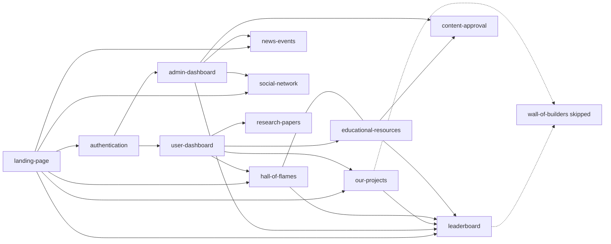

# Advait Club Website — Module Docs

One file per module, all linked to each other. Built in Next.js. Start here.

## Modules
| Module | Route | Access | Status |
|---|---|---|---|
| [landing-page](landing-page.md) | `/` | Everyone | Active |
| [authentication](authentication.md) | `/login` | Everyone | Active |
| [user-dashboard](user-dashboard.md) | `/dashboard` | User | Active |
| [admin-dashboard](admin-dashboard.md) | `/admin` | Admin | Active |
| [hall-of-flames](hall-of-flames.md) | `/hall-of-flames` | Everyone read, user write | Active |
| [our-projects](our-projects.md) | `/projects` | Everyone read, user write | Active |
| [educational-resources](educational-resources.md) | `/resources` | Everyone read, user submit, admin approve | Active |
| [research-papers](research-papers.md) | panel in `/dashboard` | User | Active |
| [leaderboard](leaderboard.md) | `/leaderboard` | Everyone | Active (rule TBD) |
| [news-events](news-events.md) | `/news` | Everyone read, admin write | Active |
| [social-network](social-network.md) | `/social` | Everyone | Active |
| [wall-of-builders](wall-of-builders.md) | `/builders` | Everyone | Skipped |

## Cross-cutting docs
- [architecture](architecture.md) — layers, folders, request flow
- [roles-and-permissions](roles-and-permissions.md) — who can do what
- [data-model](data-model.md) — entities and relationships
- [content-approval](content-approval.md) — submit, review, publish
- [module-template](module-template.md) — how to add or enable a module

## How the modules connect

## Suggested reading order
1. [architecture](architecture.md) and [roles-and-permissions](roles-and-permissions.md)
2. [landing-page](landing-page.md) → [authentication](authentication.md) → the two dashboards
3. The feature modules, then [leaderboard](leaderboard.md)
4. [data-model](data-model.md)

## Conventions
- "Proposed" API routes and fields are suggestions to confirm, not decisions.
- **Open question** marks something not yet decided.
- Every module file ends with a **Connected modules** list.
